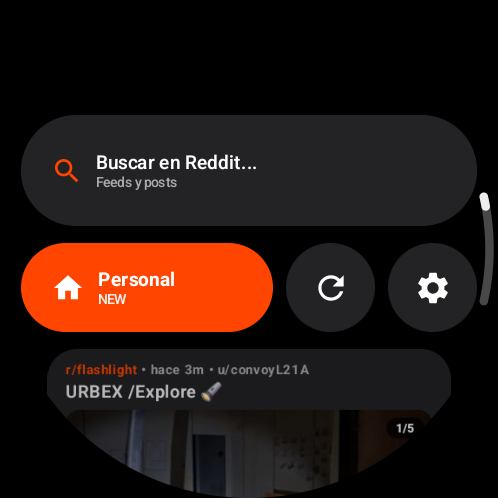
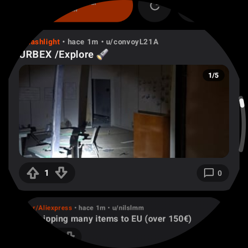
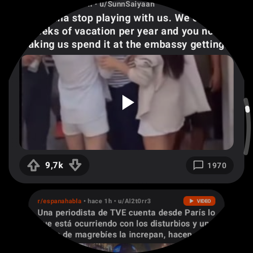
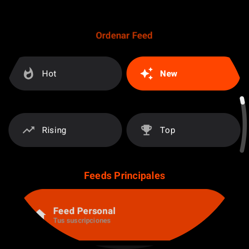
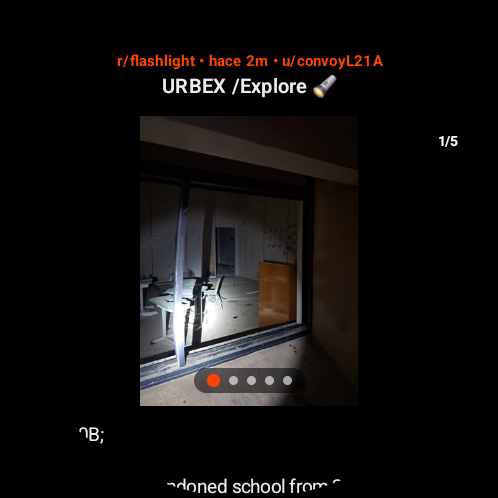
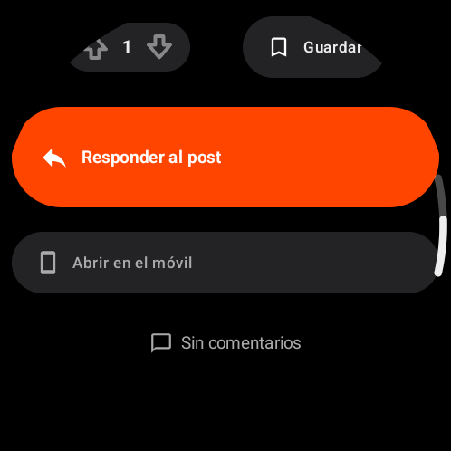
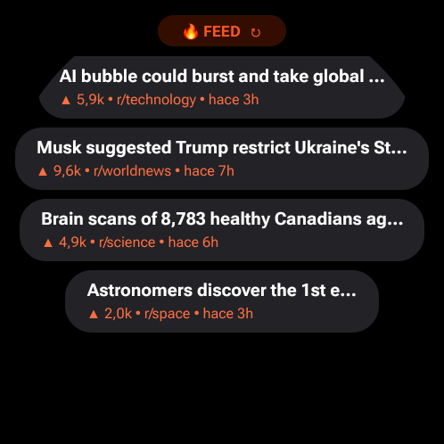
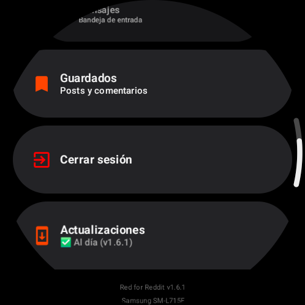
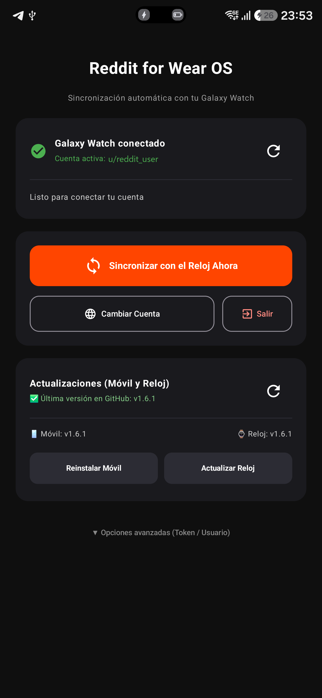

<p align="center">
  
</p>

<h1 align="center">Red for Reddit</h1>

<p align="center">
  <b>Modern Reddit Client for Wear OS Smartwatches & Android Mobile Companion</b><br/>
  <sub>Jetpack Compose · Pure Monochrome AOD · HLS Native Video · Rotary Bezel Input · 1-Tap Account Sync · Standalone OTA</sub>
</p>

<p align="center">
  <a href="https://github.com/Aaronhrndz/Reddit-for-Wear-OS/releases/latest">
    
  </a>
  <a href="https://ko-fi.com/aaronhrndz">
    
  </a>
  <a href="LICENSE">
    
  </a>
  
</p>

> **Disclaimer**: *Red for Reddit is an unofficial, community-driven open-source client. It is not affiliated with, endorsed, sponsored, or associated with Reddit Inc. in any way.*

---

## Screenshots

### Wear OS Smartwatch App

| Home Feed & Search | Photo Gallery (`1/5`) | Native Video (`HLS`) | Feed & Sort Selector |
| :---: | :---: | :---: | :---: |
|  |  |  |  |
| **Post Detail Carousel** | **Reply, Save & Open on Phone** | **Full-Circle Glanceable Tile** | **Settings & In-App OTA** |
|  |  |  |  |

### Android Phone Companion App (1-Tap Session Sync & Remote Watch OTA)

<p align="center">
  
</p>

---

## ✨ Features

### ⌚ On Watch (Wear OS)
* **📱 Continuous Reading on Always-On Display (AOD)**:
  * When lowering your wrist, **the exact post, news item, or feed you are reading remains on screen** without blur or intermediate standby screens.
  * **Pure GPU Monochrome Mode**: The interface instantly switches to high-contrast grayscale on a pure black background (`#000000`) to preserve battery life on LTPO / Super AMOLED displays at 1 Hz.
* **▶️ Native Video Player with HLS Audio (`WearVideoPlayer`)**:
  * Smooth playback powered by ExoPlayer (Media3), prioritizing official **HLS streams (`HLSPlaylist.m3u8`)** with CMAF-muxed audio, with automatic fallback to progressive MP4.
  * Tap-to-pause, infinite looping, and audio toggle (Mute/Unmute).
* **🖼️ Photo Gallery Carousel (`PostImageCarousel`)**:
  * Native multi-image album support (`gallery_data` + `media_metadata`) with `1 / N` feed badge and interactive viewer in post details.
* **🕒 Relative Time Badges (`formatRelativeTime`)**:
  * All post cards, detail screens, and comments display relative publish timestamps (`now`, `15m`, `4h`, `3d`) localized alongside subreddit and author (`r/subreddit • 3h • u/author`).
* **✏️ Full Comment Management (Reply, Edit & Delete)**:
  * Reply to posts or comments using voice input or on-screen keyboard; edit or delete your own comments with 2-tap safety confirmation.
* **🔎 Search with Sort & Time Filters**:
  * Search communities (`Feeds`) or submissions (`Posts`) with 1-tap filtering by **Sort** (*Relevance, New, Hot, Top, Comments*) and **Time Range** (*All Time, Year, Month, Week, Today*).
* **⌚ 3 Interactive Wear OS Tiles**:
  * **🔥 Personal Feed (`RedditTileService`)**: Displays your top 4 feed posts in a curved circular layout with score, subreddit, relative time, 1-tap instant refresh (`↻`), and direct post deep-linking.
  * **🔖 Saved Posts (`SavedTileService`)**: Quick access to your latest 4 saved posts directly from your Tile carousel.
  * **⚡ World News Flash (`NewsTileService`)**: Real-time breaking headlines from `r/worldnews`.
* **🔄 Quick Refresh Button**:
  * Header shortcut to refresh the feed on demand without restarting or losing scroll position.
* **👑 Fully Functional Personal Feed & Saved Posts**:
  * Loads all your subreddit subscriptions, saved posts (with auto-username resolution and smart retry), and Popular / All / Home views.
* **🎨 High-Contrast AMOLED Cards**:
  * AMOLED-optimized cards (`#232326`) with subtle borders (`#38383E`) and dedicated score/comment pill badges.
* **🌀 Rotary Bezel & Crown Support**:
  * Haptic scrolling with smooth acceleration via Horologist Rotary.
* **🌐 Multilingual Support**:
  * Built-in support for English, Spanish, French, German, Italian, and Portuguese.

### 📱 On Phone (Mobile Companion & Session Persistence)
* **✨ Clean 1-Tap Interface**:
  * Minimalist dashboard showing Bluetooth watch status, active account (`u/username`), direct **"Sync to Watch Now"** button, and login controls. Advanced diagnostics (cookie/token inspect) are neatly tucked into expandable options.
* **🔐 Persistent Long-Lived Session (`reddit_session` — 6 to 12 months)**:
  * **Smart Cookie Extraction**: Mobile companion automatically flags *"Remember Me"* (`rem = true`) on `old.reddit.com/login` and extracts the long-term signed cookie `reddit_session` (valid 6-12 months) rather than the ephemeral 24-hour `token_v2`.
  * **Autonomous Watch Renewal (Zero Phone Dependency)**: The watch stores `reddit_session` and real JWT expiration (`exp`) in `TokenStorage`, renewing `modhash` (`uh`) and session state independently against `https://old.reddit.com/api/me.json`.
  * **Bluetooth Auto-Sync**: Automatically picks up active cookies from system `CookieManager` upon app launch and transfers them to the watch via Wearable Data Layer API (`/reddit/auth_sync`).
* **🎨 Modern App Icon**:
  * Crisp vector styling with bold white typography on vibrant Reddit orange (`#FF4500`).

---

## 📲 Quick Installation (Via USB / Wireless ADB)

### 1. Enable Wireless Debugging
1. On your **Galaxy Watch** and **Android Phone**, open **Settings** -> **Developer options**.
2. Enable **ADB debugging** and **Wireless debugging**.
3. Note the IP address and 5-digit port for each device.

### 2. Install APKs

```powershell
# Android Phone (USB or Wi-Fi)
adb -s <PHONE_IP_OR_SERIAL> install -r mobile\build\outputs\apk\debug\mobile-debug.apk

# Galaxy Watch (Ultra / 7 / 6 / 5 / 4)
adb connect 192.168.1.173:<WATCH_PORT>
adb -s 192.168.1.173:<WATCH_PORT> install -r wear\build\outputs\apk\debug\wear-debug.apk
```

---

## 🛠️ Building from Source

A self-contained PowerShell build script is included:

```powershell
# Build both Mobile and Wear OS modules and generate APKs
.\build.ps1
```

---

## 🏗️ Tech Stack

* **Language**: Kotlin 2.0
* **UI Toolkit**: Jetpack Compose for Wear OS + Wear Material + Horologist 0.6.x + Compose Material 3 (Mobile)
* **Networking**: Ktor HTTP Client (CIO engine) + OkHttp + Kotlinx Serialization (`old.reddit.com` / `oauth.reddit.com` dual-mode)
* **Authentication**: Signed `reddit_session` cookie + CSRF `modhash` (`uh`) + OAuth2 `Bearer` support
* **Video & Media**: Media3 ExoPlayer (`HlsMediaSource` + `ProgressiveMediaSource`) + Coil Compose
* **Display Engine**: BlendMode GPU Grayscale Shader + AmbientModeSupport
* **Secure Storage**: `TokenStorage` (`SharedPreferences` with JWT `exp` parsing)
* **Inter-device Sync**: Google Play Services Wearable API (`MessageClient` + `DataClient` + `CapabilityClient`)

---

## ☕ Support & Donations

If Red for Reddit made your smartwatch experience significantly better, consider supporting future development with a coffee:

<p align="center">
  <a href="https://ko-fi.com/aaronhrndz"></a>
</p>

---

## 📄 License

This project is licensed under the **GNU General Public License v3.0 (GPLv3)**. See [LICENSE](LICENSE) for full details. Any derivative work or modification must remain free, open-source, and under this identical license.

